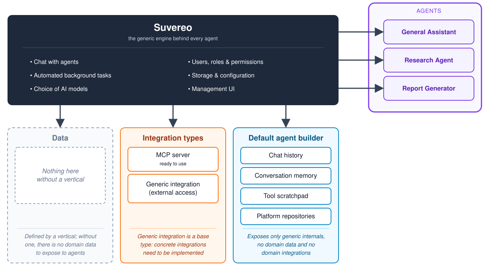
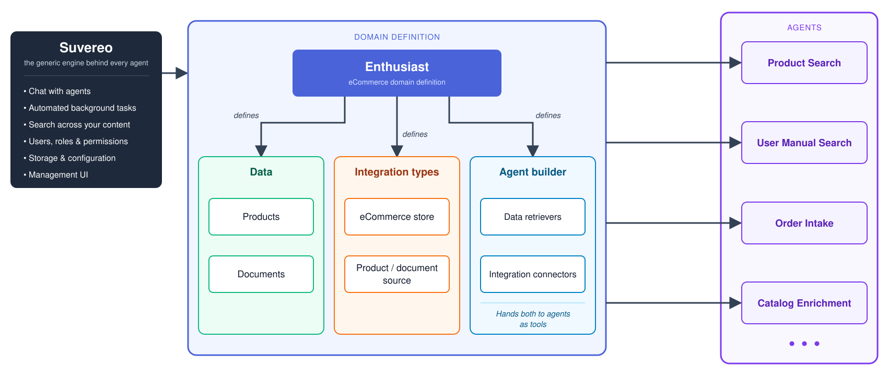
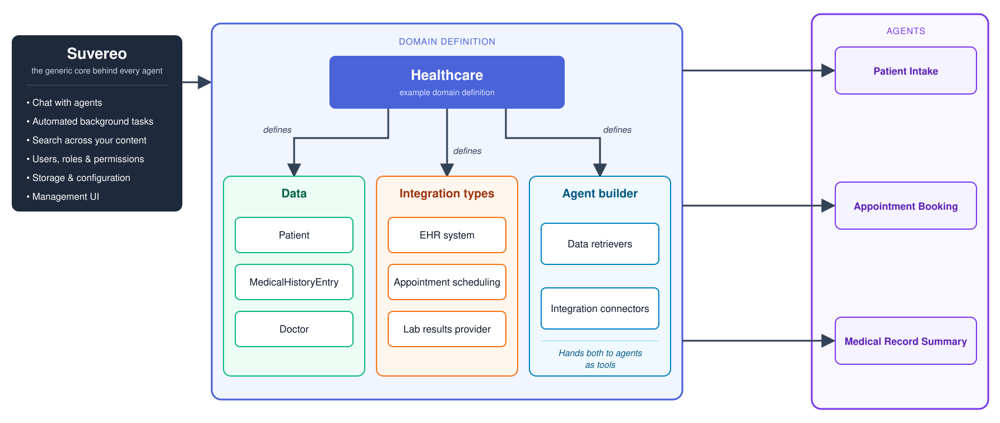

# Domain onboarding

An [agent](/docs/concepts#agent) is only as useful as the data and systems it can reach. A support agent needs your tickets and your help desk, an agent for a store needs the catalog and the order system, and an agent for a clinic needs patient records and the appointment calendar. Suvereo takes care of what stays the same from one [domain](/docs/concepts#domain) to another, and lets you describe what is specific to yours.

This page explains how that split works, so you can see what Suvereo gives you from the start and what you add to bring in a new domain.

## What Suvereo provides on its own

Suvereo is the generic core behind every agent. Whatever the domain, it provides:

- **Chat with agents** - [conversations](/docs/concepts#conversation) in the web UI.
- **Automated background tasks** - [agentic executions](/docs/concepts#agentic-execution), started through the API.
- **Choice of AI models** - the language and embedding model providers, chosen per [data set](/docs/concepts#data-set).
- **Users, roles and permissions** - who can do what, globally or within a data set.
- **Storage and configuration** - data sets, and the settings of agents and [integrations](/docs/concepts#integration).
- **Management UI** - a web frontend, integrated with the API, for managing data sets, agents, integrations, users and access.

Three things in that picture depend on the domain: the data agents work on, the kinds of external systems that can be connected, and the way both reach an agent. The diagram below shows Suvereo without any domain added.

Without a domain, each of the three has a generic form:

- **Data** is empty. Suvereo defines no data of its own, so there is nothing domain-specific to expose to agents.
- **Integration types** include a ready-to-use [MCP server integration](/plugins/mcp), which connects an MCP server to a data set and makes its [tools](/docs/concepts#tool) available to the agents that select it under **Tool sources**. The generic integration type is a base for building your own domain-agnostic integrations, for example one that gives agents tools for an external service. Integrations that sync content in need [entities](/docs/concepts#entity) to store it in, so they are defined together with a domain definition.
- **The default agent builder** gives agents what every agent can use: chat history, conversation memory, a scratchpad for tool results and the platform's repositories. It carries no domain data and no domain integrations.

Agents built on this foundation, such as a general assistant, a research agent or a report generator, can work with these basics and with the tools of a connected MCP server.

## What a domain definition contains

To bring a domain in, you describe it in a [domain definition](/docs/concepts#domain-definition): an extension of Suvereo that can supply its data, integration types and agent builder in a form that fits the domain. Suvereo provides the rest.

| A domain definition contains | What it means |
|---|---|
| **Data** | The entities of the domain, such as products or patients. Suvereo stores them, lists them in the UI and indexes their content, so agents can search it by meaning. |
| **Integration types** | The kinds of external systems the domain relies on. Some bring data in, for example a source that syncs records from an electronic health record system. Others let agents act in a system, for example an appointment scheduling service. |
| **The agent builder** | How the data and the integrations reach agents. It hands data retrievers, which search the domain definition's data, and integration connectors, which reach its external systems, to agents as tools. |

Conversations, agentic executions, permissions, models and the UI are not part of a domain definition, since they come from Suvereo. A domain definition covers what is specific to the domain.

Agents are then built on top of the domain definition. They can use its data, its integrations and the tools the builder provides, and they can also use everything the standalone setup offers. An agent can be shipped as a plugin, as part of a domain definition, or in the Suvereo codebase itself. See [Agent architecture](/docs/agents/agent-architecture) for the parts an agent is made of and [Injector](/docs/agents/injector) for how a domain definition supplies its resources to them.

## Example: Enthusiast

[Enthusiast](/tools/enthusiast) is a domain definition for e-commerce. It describes a store in the three parts:

- **Data:** products and documents.
- **Integration types:** an e-commerce store type, which acts in a store platform such as Shopify or Shopware, and product and document source types, which sync content in from platforms and content systems.
- **Agent builder:** data retrievers for products and documents, and connectors for the store platform.

Agents such as Product Search, User Manual Search, Order Intake and Catalog Enrichment (and others) are built on top of it.

## Example: healthcare

The same structure can describe a different domain. The diagram below is an illustration of how a healthcare domain definition could be laid out.

- **Data:** patients, medical history entries and doctors.
- **Integration types:** an electronic health record system, appointment scheduling and a lab results provider.
- **Agents:** for example Patient Intake, Appointment Booking and Medical Record Summary.

## Where to go next

- [System architecture](/docs/customization/system-architecture) shows the components and server modules that this split runs on.
- [Using the Suvereo starter](/docs/customization/using-the-suvereo-starter) covers setting up a codebase for your own extensions.
- [Concepts](/docs/concepts) defines the terms used on this page.
