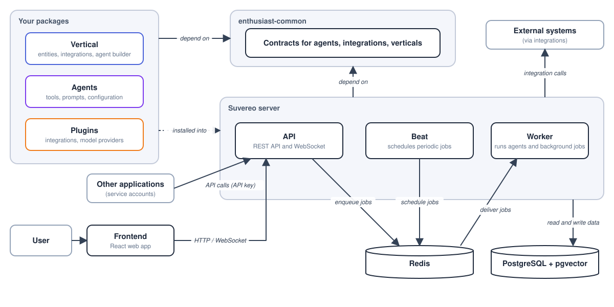
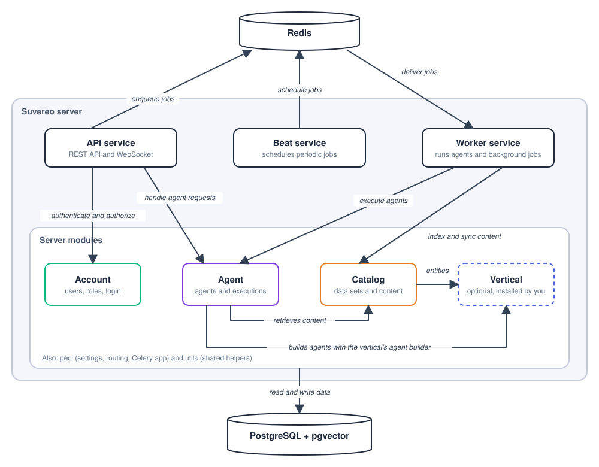

# System Architecture

Suvereo consists of two main applications:

1. Server - A Python-based server that contains the core application logic. It is deployed as three separate processes:
    - API - handles requests from the frontend and from other applications that authenticate with an API key, and streams [conversations](/docs/concepts#conversation) over WebSocket.
    - Worker - executes agent requests, [agentic executions](/docs/concepts#agentic-execution) and [integration](/docs/concepts#integration) synchronization in the background.
    - Beat - schedules periodic jobs, such as cleaning up uploaded files and removing expired refresh tokens.
2. Frontend - A React-based web application used to work with and configure Suvereo.

The server stores its data in PostgreSQL with the pgvector extension, which also holds the embeddings used for search. Redis carries the job queue between the API, Beat and the Worker.

Other applications can call the API by authenticating as a service account with an API key. In the other direction, the server reaches external systems through integrations. The Worker calls them when it runs agents, agentic executions and synchronization.

Your own code can be installed into the server. A [domain definition](/docs/concepts#domain-definition) and [plugins](/docs/concepts#plugin), such as custom agents and integrations, can depend on `suvereo-common`, which defines the contracts the server loads them through.

## Server Architecture

The server is organized into a few modules that interact with each other:

1. Account - handles users, groups, roles, service accounts and authentication with access and refresh tokens
2. Agent - manages the state of agents and conversations, and orchestrates agentic workflows and agentic executions
3. Catalog - manages [data sets](/docs/concepts#data-set), integrations, and the indexing and retrieval of content
4. Pecl - holds the project settings, URL routing and the Celery app
5. Utils - holds helpers shared by the other modules, such as base registries and serializers

The modules are extended by a domain definition when one is enabled. A domain definition declares its [entities](/docs/concepts#entity), which Catalog stores and indexes, and its agent builder, which the Agent module uses to build agents. It is enabled in the instance settings, and Suvereo also runs without one.

## Suvereo Common

The [suvereo-common](https://github.com/upsidelab/suvereo/tree/main/plugins/suvereo-common) package provides the interfaces used for building agents, integrations, domain definitions and other extensions, without pulling the whole server implementation into your codebase. The server depends on these interfaces rather than on concrete plugins, and plugins depend on `suvereo-common` rather than on the server.

We recommend building your custom agents and integrations as plugins that depend on `suvereo-common` and are installed inside Suvereo. This makes it easier to upgrade the core of the system in the future.
